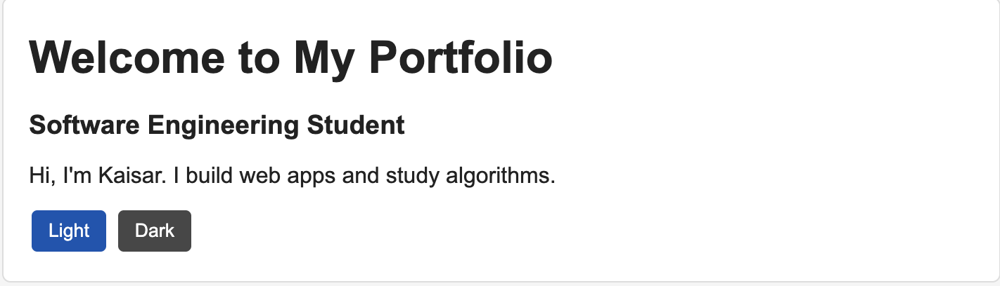
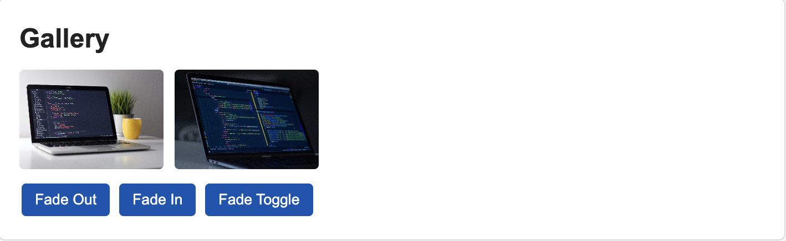
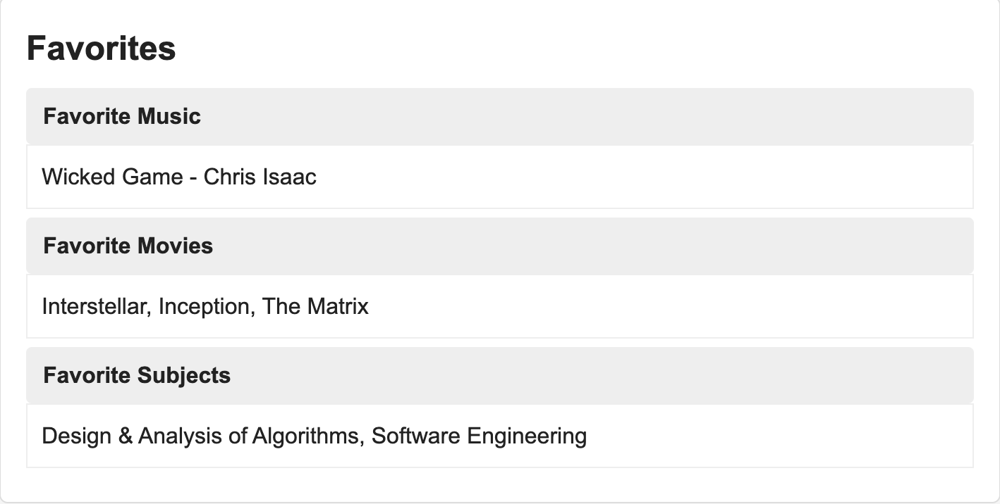
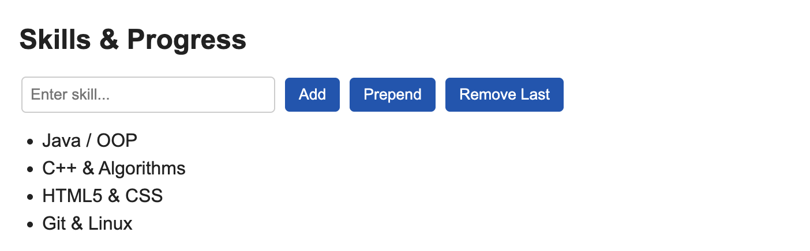
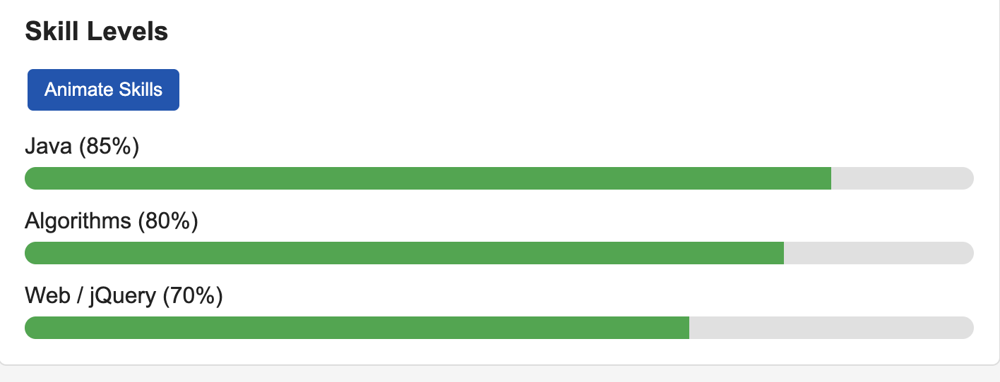
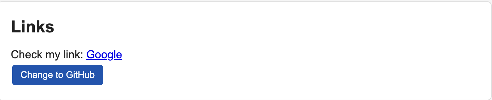
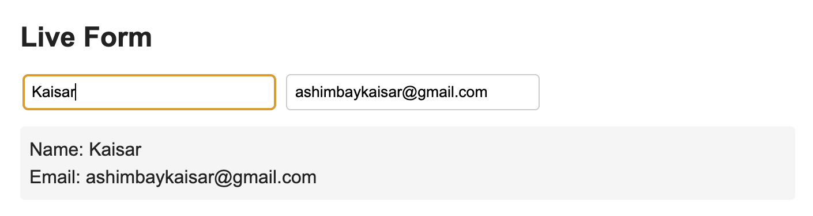

# Assignment 6: jQuery (Selectors, Effects, Animations)

**Name:** Kaisar Ashimbay  
**Group:** SE-2540  

---

## Overview

In this assignment, I created a simple portfolio web page to practice basic jQuery concepts, including element selection, DOM manipulation, UI effects, form handling, and custom animations.

---

## Tasks Completed

### Task 0. Setup
Included jQuery 3.7.1 via CDN inside `<head>` and verified execution inside `$(document).ready()` with a `console.log()` statement.

### Task 1. Selectors & CSS
Added personal introductory text and headings. Implemented light/dark theme switching using `.addClass()` and `.removeClass()`.

### Task 2. Visibility Methods
Created an "About Me" section and controlled element visibility using `.hide()`, `.show()`, and `.toggle()`.

### Task 3. Fade Methods
Created an image gallery and applied `.fadeIn()`, `.fadeOut()`, and `.fadeToggle()` effects.

### Task 4. Slide Methods
Built an accordion-style favorites section using `.slideToggle()` to collapse and expand details.

### Task 5. Add & Remove Elements
Added an input field and buttons to dynamically manage a list of technical skills using `.append()`, `.prepend()`, and `.remove()`. Added checks to ignore empty inputs.

### Task 6. Modifying Attributes
Used `.attr()` to dynamically update the `href` attribute and link text pointing to my GitHub profile.

### Task 7. Form Interaction
Created a contact form that displays live updates of user input using the `input` event along with `.val()` and `.text()`.

### Task 8. Basic Animation
Constructed skill progress bars with an "Animate Skills" button that animates widths from `0%` to target percentages and back using `.animate()`.

